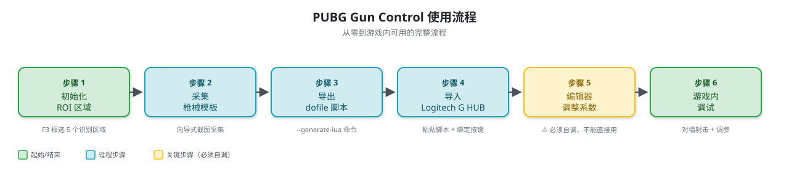
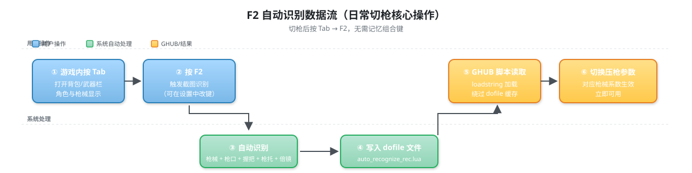
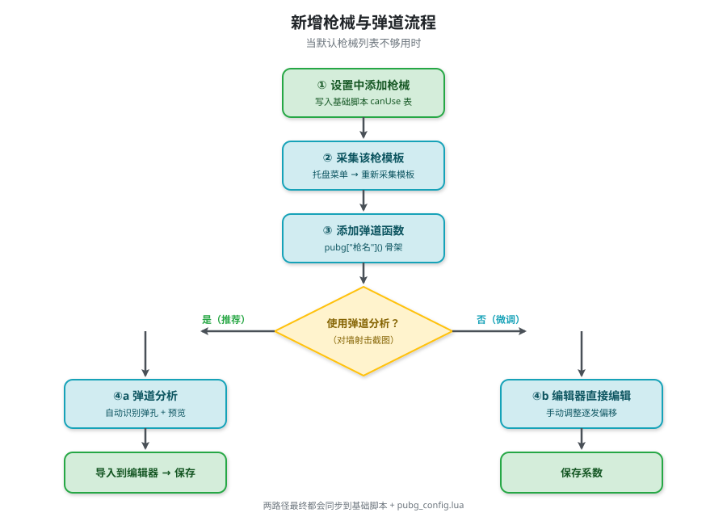

# PUBG Gun Control

一款配合罗技G HUB压枪宏在PUBG游戏中使用的枪械切换显示与自动识别工具。通过监听鼠标和键盘组合键，在屏幕左上角显示当前选中的枪械名称、倍镜与配件；并支持截图自动识别当前武器与配件，把识别结果写入 `rec.lua` 供 GHUB 脚本读取，实现"切枪即生效"的压枪参数自动切换。

此外还提供**姿态识别**（自动切换站立/下蹲/趴姿系数）、**闭环弹道自动校准**（射击后由算法自动反推补偿表）与**屏幕中心准星**三项辅助功能。

[English Version](README-EN.md)

## 目录

- [功能特性](#功能特性)
- [快速开始（核心使用流程）](#快速开始核心使用流程)
- [进阶：新增枪械与弹道](#进阶新增枪械与弹道)
- [功能详解](#功能详解)
- [按键说明](#按键说明)
- [配置文件说明](#配置文件说明)
- [项目结构](#项目结构)
- [常见问题](#常见问题)
- [开发](#开发)
- [更新日志](#更新日志)

---

## 功能特性

### 显示与切换
- 屏幕左上角浮窗显示枪械名称、倍镜、配件信息（白底红字，置顶显示）
- 浮窗鼠标穿透，不干扰游戏操作
- 浮窗位置可解锁拖动，坐标持久化保存
- 支持多种枪械切换组合
- 大写锁定键控制压枪模式开关
- 配件循环切换（枪口 / 握把 / 枪托）
- 倍镜模式切换（1x / 2x / 3x），浮窗左上角显示当前倍镜
- 枪械锁定功能（锁定后浮窗变黄色，无法切换）
- 一键重置所有状态

### 姿态识别（站立 / 蹲下 / 趴下）
- **自动跟踪角色姿态**：监听游戏按键自动推断当前姿态，把结果写入 `rec.lua` 的 `rec_stance`，GHUB 脚本按姿态切换后坐力系数
- 默认 **C = 蹲下**、**Z = 趴下**、**Space = 打断键**（跳跃/翻越时强制回到站立），按键可在设置中自定义
- **打断机制**：长按 C 只翻转一次（press/release 配对），避免 Windows 按键自动重复导致姿态抖动
- **焦点过滤**：仅当 PUBG 处于前台时更新状态，避免在桌面聊天打字时误触发
- **手动纠正**：托盘菜单 → "姿态重置为站立"，应对被击倒、上下载具、游泳等导致的姿态漂移
- **基准姿态换算**：弹道表基准可选 `stand` / `crouch`，选 `crouch` 时站立补偿 = 1 / 下蹲系数（编辑器有实时换算提示）

### 闭环弹道自动校准
- **全自动化**：从编辑器「工具 → 闭环弹道校准…」启动，无需人工拖拽弹孔
- **闭环迭代（ILC）算法**：第 0 轮无补偿裸扫测原始后坐力曲线 → 后续每轮用当前补偿表压枪并测量残余漂移 → 迭代 2~3 轮收敛
- **屏幕像素域追踪**：用 OpenCV 模板匹配逐帧追踪世界参照物相对屏幕中心的漂移，得到后坐力曲线，再按射速间隔切成逐发增量
- **自动换算写回 Lua**：`V(k) = P*(k) / ((ADS/100) × 枪械自身系数)`，倍镜与姿态差异由 Lua 侧系数处理
- **非模态向导**：校准在独立线程运行，日志实时输出，结果先应用到编辑器内存配置（标脏），确认无误后再走正常保存流程写回 lua
- 支持两种模式：自动迭代（ILC）与手动逐轮确认

### 屏幕中心准星
- 在屏幕中心绘制自定义准星，解决 PUBG 人物奔跑时准星跟随不上、丢失准星点的问题
- 形状可选：十字 / 点 / 圆环 / 十字带点；颜色与大小可自定义，实时预览
- 两种显示模式：**常驻显示** 或 **长按按键显示**（默认长按 Shift）
- 多显示器支持，准星自动跟随鼠标所在显示器
- 准星窗口鼠标穿透、置顶，不干扰游戏操作

### 自动识别
- **截图识别当前武器**：按 F2 截图，自动识别当前手持枪械、枪口、握把、枪托、倍镜，并写入 `rec.lua`
- **dofile 模式导出**：导出 `auto_recognize_ghub.lua` + `auto_recognize_rec.lua`，GHUB 脚本通过 `loadstring` 加载识别结果，无需每次重新导出
- **动态枪械列表**：枪械列表与武器类型映射（AR / SMG）从基础脚本 `canUse` 分组动态推断，新增枪械后无需手动维护映射表
- **ROI 区域可视化框选**：全屏截图上框选识别区域，支持 BackSpace 回退到上一区域
- **模板向导式采集**：枪口按武器类型分组（AR / SMG）采集，倍镜支持机瞄/红点/全息等

### 编辑器（弹道系数可视化）
- 8 个枪械系数（自身 / 下蹲 / 屏息 / 裸配 / 满配 / 趴姿 / 2 倍镜 / 3 倍镜）可视化调整
- 模式切换（0 禁用 / 1 启用 / 2 连点）
- 配件下拉选择（5 枪口 × 6 握把 × 3 枪托）+ 满配综合系数自动计算
- matplotlib 弹道轨迹预览，实时显示调参效果
- 1x / 2x / 3x 倍镜切换与多倍镜叠加对比
- 预设管理（保存 / 加载 / 删除），按 DPI / 分辨率 / 鼠标型号切档
- 保存时自动同步到基础脚本与 `pubg_config.lua`，并生成 `.bak` 备份

### 弹道分析
- **多策略弹孔检测**：灰色弹孔优先 → 绿色标记点（blob_log）→ OpenCV 轮廓，自动选择最优策略
- **整匣规范与逐发对齐**：支持把识别点重采样到指定发数，沿弧长均匀插值补齐漏检
- **可视化预览**：分析完成后弹出预览窗口，红色圆点为原始识别点，蓝色叉号为重采样点，绿色点划线为段分割位置，用户确认合理后再保存

### 其他
- 按键操作语音提示（压枪开关、锁定/解锁、锁定拦截），支持音量调节与单事件开关
- 设置窗口标签页布局（基础 / 枪械 / 识别 / 语音 / 准星）
- 配置文件持久化（`config.json` + `recognition.json`）
- 配合罗技G HUB压枪宏使用

---

## 快速开始（核心使用流程）

本节按时间顺序说明从零到游戏内可用的完整流程，新用户按此操作即可。每个步骤都预留了截图位置（标记为 `<!-- 截图：xxx -->`），后续会补充。

### 流程总览

```
1. 初始化 ROI 区域    → 2. 采集枪械模板     → 3. 导出 dofile 脚本
   ↓
4. 导入 Logitech G HUB → 5. 编辑器调整系数   → 6. 游戏内调试
```

完成后即可正常使用。之后如需新增枪械/弹道，见 [进阶：新增枪械与弹道](#进阶新增枪械与弹道)。



---

### 步骤 1：初始化 ROI 区域

ROI（Region of Interest）是屏幕上需要识别的几个区域：武器名称、枪口/握把/枪托配件图标、倍镜图标。程序靠这些区域截图来识别当前手持武器。

#### 1.1 设置基础脚本路径（前提）

首次启动前，先在设置中指定基础脚本路径：

```bash
uv run python main.py
```

启动后通过托盘菜单 → "设置" → "识别" 标签页，把"基础脚本"指向你的 `1.2.2-2024.5.20.-GHUB.-github.lua` 路径。

**这一步是后续所有功能的前提**：
- 枪械列表从基础脚本的 `canUse` 表读取
- 武器类型映射（AR / SMG）从弹药口径推断
- 弹道分析读取每把枪的 `interval` 与弹道数据
- 编辑器保存时同步写回基础脚本

<!-- 截图：设置窗口-识别标签页-基础脚本路径 -->

#### 1.2 启动 ROI 框选

通过托盘菜单 → "重新框选 ROI 区域"，或命令行：

```bash
uv run python main.py --init-roi
```

按 **F3** 截屏后，在全屏截图上依次框选 5 个区域：

| 区域 | 说明 |
|------|------|
| 武器名称区域 | 显示当前枪械名称的位置 |
| 枪口配件图标区域 | 枪口图标位置 |
| 握把配件图标区域 | 握把图标位置 |
| 枪托配件图标区域 | 枪托图标位置 |
| 倍镜信息区域 | 倍镜图标位置（可选，按 Esc 跳过） |

**操作提示：**
- 选错时按 **BackSpace** 回退到上一个区域，无需全部重来
- 倍镜区域可选，不需要时按 **Esc** 跳过
- 截屏前程序会自动隐藏准备窗口 0.3 秒，避免截到自身残影

<!-- 截图：ROI 框选界面 -->

---

### 步骤 2：采集枪械模板

模板是识别引擎用来匹配的"标准图片"。程序需要为每把枪、每个配件采集一张模板。

#### 2.1 启动模板采集

通过托盘菜单 → "重新采集模板"，或使用一键初始化：

```bash
uv run python main.py --init
```

`--init` 会自动检测：如果已有 ROI 则直接进入模板采集，没有则先框选 ROI。

<!-- 截图：托盘菜单-重新采集模板 -->

#### 2.2 采集流程

模板采集是向导式的，按提示在游戏内切换武器并截图：

1. **枪械模板**：对每把枪截图（武器名称区域）
2. **枪口模板（AR）**：对 AR 类枪口配件截图（补偿器/消焰器/消音器/制退器）
3. **枪口模板（SMG）**：对 SMG 类枪口配件截图
4. **握把模板**：对握把配件截图（垂直/斜向/拇指/半截/轻型）
5. **枪托模板**：对枪托配件截图（战术/重型）
6. **倍镜模板**：对倍镜截图（机瞄/红点/全息/2倍/3倍/4倍/6倍）

每个步骤都支持"上一步"和"跳过"。

<!-- 截图：模板采集向导界面 -->

#### 2.3 模板文件位置

模板保存在 `templates/` 目录：

```
templates/
├── guns/                  # 枪械模板（按枪名命名）
├── muzzle/ar/             # AR 类枪口模板
├── muzzle/smg/            # SMG 类枪口模板
├── grip/_shared/          # 握把模板（AR/SMG 共用）
├── stock/_shared/         # 枪托模板（AR/SMG 共用）
└── scope/                 # 倍镜模板
```

---

### 步骤 3：导出 dofile 脚本

dofile 模式把 GHUB 脚本拆成两部分：主脚本（含识别逻辑）+ 识别结果文件。GHUB 通过 `loadstring` 加载识别结果，**绕过 GHUB dofile 缓存**，编辑器保存后无需重新导出。

#### 3.1 导出命令

```bash
uv run python main.py --generate-lua
```

#### 3.2 生成的文件

导出到 `src/pubg_gun_control/generated/` 目录：

- `auto_recognize_ghub.lua`：GHUB 主脚本，含自动识别逻辑
- `auto_recognize_rec.lua`：识别结果文件，程序运行时写入

<!-- 截图：导出生成的文件 -->

---

### 步骤 4：导入 Logitech G HUB

把生成的 GHUB 脚本导入到罗技 G HUB 软件，让鼠标按键能触发压枪宏。

#### 4.1 导入脚本

1. 打开 G HUB 软件
2. 选择你的鼠标设备
3. 点击"+"添加命令
4. 选择"脚本"类型
5. 将 `1.2.2-2024.5.20.-GHUB.-github.lua`（或步骤 3 导出的 `auto_recognize_ghub.lua`）脚本内容粘贴进去

<!-- 截图：G HUB 脚本导入界面 -->

#### 4.2 鼠标按键绑定

将鼠标的**前进侧键**绑定为 **G5**，**后退侧键**绑定为 **G4**，**中键**绑定为 **G3**。

<!-- 截图：G HUB 按键绑定界面 -->

#### 4.3 灵敏度推荐配置

lua 脚本中推荐的 PUBG 游戏内灵敏度设置（仅供参考，每个用户可能不同）：

```
开镜灵敏度(ADS): 70
腰射灵敏度(Aim): 0.55
2倍镜: 1.4
3倍镜: 3.6
4倍镜: 3.0
6倍镜: 1.25
DPI: 1400
分辨率: 1080P
```

#### 4.4 枪械切换：两种方式对比（强烈推荐 F2 自动识别）

本项目支持两种枪械切换方式：

| 方式 | 操作 | 适用场景 |
|------|------|---------|
| **F2 自动识别（推荐）** | 游戏内按 Tab 显示武器栏 → 按 F2 | ✅ 切枪即生效，无需记组合键 |
| 组合键切换（传统） | LAlt/LCtrl/LShift + 鼠标侧键 | ⚠️ 需要记按键映射，已不推荐 |

**F2 自动识别的优势**：

- 游戏内按 Tab 打开背包/武器栏，角色与枪械会显示在屏幕上
- 此时按 F2，程序会自动识别当前手持的枪械、枪口、握把、枪托、倍镜
- 识别结果**直接写入 dofile 文件**（`auto_recognize_rec.lua`）
- GHUB 中运行的脚本会读取该文件，自动切换到对应枪械的压枪参数
- **完全不需要按组合键切换**，切枪后按 F2 即可

```
游戏内按 Tab 显示武器 → 按 F2 截图识别 → 写入 dofile 文件 → GHUB 脚本自动切换压枪参数
```

<!-- 截图：游戏内 Tab 显示武器 + F2 识别效果 -->



#### 4.5 宏脚本的枪械配置（传统组合键，作为备用方案）

如果你仍习惯使用组合键切换，lua 脚本中的 `G_bind` 配置了鼠标按键与枪械的映射关系：

```lua
-- LAlt + G键 切换枪械
["lalt + G4"] = "UMP45"        -- 左Alt + 鼠标侧键后退 = UMP5压枪
["lalt + G5"] = "MP5K"         -- 左Alt + 鼠标侧键前进 = MP5K压枪

-- LCtrl + G键 切换枪械
["lctrl + G4"] = "ACE32"       -- 左Ctrl + 鼠标侧键后退 = ACE32压枪
["lctrl + G5"] = "M416"        -- 左Ctrl + 鼠标侧键前进 = M416压枪

-- LShift + G键 切换枪械
["lshift + G4"] = "AUG"        -- 左Shift + 鼠标侧键后退 = AUG压枪
["lshift + G5"] = "Beryl M762" -- 左Shift + 鼠标侧键前进 = Beryl M762压枪
```

**建议**：日常使用直接按 F2 自动识别即可，组合键只在自动识别失败（如 ROI 不准、模板模糊）时作为备用方案。

---

### 步骤 5：打开编辑器调整系数

**⚠️ 重要：每个用户的鼠标 DPI、游戏内灵敏度都不一样，必须自行调整系数才能压得住枪！** 别人调好的系数直接用会飘。

#### 5.1 启动编辑器

通过托盘菜单 → "打开编辑器"，或独立运行：

```bash
uv run python main_editor.py
```

<!-- 截图：编辑器主界面 -->

#### 5.2 编辑器布局

三栏布局：
- **左侧**：枪械列表（按弹药口径分组）
- **中间**：系数编辑面板（8 个系数 + 模式 + 配件）
- **右侧**：弹道轨迹预览（matplotlib）

顶部菜单：文件 / 工具 / 预设 / 帮助

<!-- 截图：编辑器三栏布局 -->

#### 5.3 打开 config 脚本

编辑器启动后默认会加载基础脚本（`1.2.2-2024.5.20.-GHUB.-github.lua`）。也可以通过"文件"菜单 → "打开"选择其他脚本。

#### 5.4 调整系数

1. 在左侧列表选择枪械
2. 在中间面板调整 8 个系数（自身/下蹲/屏息/裸配/满配/趴姿/2 倍镜/3 倍镜）
3. 选择模式（0 禁用 / 1 启用 / 2 连点）
4. 选择配件组合，满配综合系数自动计算
5. 右侧实时预览弹道轨迹

**系数含义**：系数是压枪力度的倍率。例如"自身"系数 5.48 表示该枪基础压枪力度是基准的 5.48 倍。系数越大压得越狠，过大会导致子弹往下飘，过小会往上飘。

<!-- 截图：编辑器-系数编辑面板 -->

#### 5.5 保存配置

保存时会自动：
1. 备份当前基础脚本为 `.bak`
2. 写入当前枪械的系数到基础脚本
3. 同步到 `pubg_config.lua`

**注意**：使用"保存"而非"另存为"——另存为新文件时不会同步基础脚本。

<!-- 截图：编辑器-保存 -->

---

### 步骤 6：游戏内调试

#### 6.1 启动程序

**⚠️ 重要：程序必须以管理员身份启动，否则在游戏中不会生效！**

这是因为游戏运行在较高的权限级别，普通权限的输入监听无法在游戏进程中生效。

**开发模式：**

```bash
uv run python main.py
```

**打包为 EXE：**

```bash
uv run pyinstaller pubg_gun_control.spec --clean
```

打包后的文件位于 `dist/PUBG-Gun-Control/` 目录。右键 `PUBG-Gun-Control.exe` → "以管理员身份运行"。

<!-- 截图：右键管理员身份运行 -->

#### 6.2 启动成功标志

启动后日志会输出以下内容表示一切正常：

```
[INFO] __main__: 已加载 20 把枪械名映射
[INFO] pubg_gun_control.recognizer: 已加载 21 个枪械模板
[INFO] __main__: 自动识别已启动，快捷键: f2
```

任务栏右下角会出现托盘图标。

<!-- 截图：启动日志 + 托盘图标 -->

#### 6.3 游戏内调试流程

1. 进入游戏，打开背包确保武器栏可见
2. 按大写锁定键开启压枪模式（浮窗显示枪械名称）
3. 对墙射击测试压枪效果：
   - **子弹往上飘** → 增加对应系数
   - **子弹往下飘** → 减小对应系数
4. 切回编辑器调整系数，保存
5. 重新测试，直到压得住为止
6. 测试不同姿势（站立/下蹲/屏息/趴下）和倍镜（1x/2x/3x/4x/6x）下的效果

> **不想手动试参数？** 可以用 [闭环弹道校准](#6-闭环弹道校准) 让算法自动反推补偿表（编辑器「工具 → 闭环弹道校准…」），2~3 轮收敛后再手动微调。适合新枪首次调参。

**调试技巧**：可以保存多套预设（按 DPI / 分辨率 / 鼠标型号命名），方便切换。

**姿态识别验证**：游戏内按 **C** 应切蹲下、**Z** 应切趴下、**Space** 应回到站立。若浮窗姿态与实际不符，见 [Q7](#q7姿态识别不生效--状态与游戏不一致)。

<!-- 截图：游戏内浮窗显示 -->

#### 6.4 自动识别使用（日常切枪的核心操作）

**这是日常使用中最常用的操作，比组合键切换更方便。**

操作流程：

1. 游戏内切换武器后，按 **Tab** 键打开背包/武器栏（角色和枪械会显示在屏幕上）
2. 按 **F2**（可在设置中修改）触发识别
3. 程序自动识别当前手持的：枪械、枪口、握把、枪托、倍镜
4. 识别结果**直接写入 dofile 文件**（`auto_recognize_rec.lua`）
5. GHUB 中运行的脚本读取该文件，自动切换到对应枪械的压枪参数

```
切枪 → 按 Tab 显示武器 → 按 F2 → 写入 dofile → GHUB 自动切换压枪参数
```

**为什么比组合键方便**：
- 无需记忆 LAlt/LCtrl/LShift + 鼠标侧键的组合映射
- 一次操作同时识别枪械 + 5 个配件（枪口/握把/枪托/倍镜）
- 配件变化（如换枪口）只需再按一次 F2 即可更新

完成以上步骤后，程序即可正常使用。

---

## 进阶：新增枪械与弹道

当默认枪械列表不够用时，可以新增枪械并为其添加弹道。



### 1. 新增枪械

#### 1.1 在设置中添加

通过托盘菜单 → "设置" → "枪械" 标签页：

1. 在对应弹药口径分组下点击"添加枪械"
2. 输入枪械名称（与游戏内显示一致）
3. 勾选该枪支持的配件类型（枪口/握把/枪托）
4. 保存

枪械会自动写入基础脚本的 `canUse` 表。

**注意**：弹药口径保留原始 key（如 `.45` 不会被映射为 `9mm`），避免破坏 `canUse` 分组结构。

<!-- 截图：设置-枪械标签页-添加枪械 -->

#### 1.2 采集该枪的模板

新增枪械后必须采集模板，否则识别不到：

1. 托盘菜单 → "重新采集模板"
2. 在枪械模板步骤中，按提示对该枪截图

<!-- 截图：模板采集-新增枪械 -->

#### 1.3 在基础脚本中添加弹道函数

新增枪械后，需要在基础脚本中添加对应的 `pubg["GunName"]` 弹道函数（即使是空函数也可以）：

```lua
function pubg["新枪名"]()
    -- 弹道数据将通过编辑器或弹道分析填充
end
```

也可以通过编辑器选择该枪后保存，会自动生成函数骨架。

### 2. 新增枪械弹道

有两种方式添加弹道数据：手动分析截图（弹道分析）或直接编辑。

#### 2.1 方式一：弹道分析（推荐）

弹道分析可以从对墙射击的截图中自动提取弹孔位置，生成弹道数据。

##### 2.1.1 启动弹道分析

通过托盘菜单 → "弹道分析" 启动。

<!-- 截图：托盘菜单-弹道分析 -->

##### 2.1.2 操作步骤

1. **选择弹孔截图**：点击"选择文件"，选一张对墙射击的弹孔截图（建议垂直对墙射击一整匣子弹后截图）
2. **输入枪械名称**：手动输入或从下拉列表选择
3. **调整参数**：
   - 射击间隔（ms）：从基础脚本自动读取，未读取到时默认 87ms
   - 缩放系数：图片与实际屏幕的比例
   - 最大段数：识别的弹道段数
   - 整匣子弹数：用于规范重采样（至少 2 发）
4. **点击"分析弹道"**：程序自动识别弹孔位置

<!-- 截图：弹道分析主界面 -->

##### 2.1.3 可视化预览

分析完成后会弹出预览窗口：

- **红色圆点**：原始识别点（raw_points）
- **蓝色叉号 + 虚线**：重采样后的规范点（points）
- **绿色点划线**：段分割位置（每段起始发数对应的 Y 坐标）

预览窗口标题会显示"识别 N 点 → 规范为 M 发"，方便确认识别准确度。

**关闭预览窗口后**才会继续弹出保存对话框。

<!-- 截图：弹道分析预览窗口 -->

##### 2.1.4 保存与导入

1. 确认预览合理后关闭预览窗口
2. 在保存对话框中选择保存位置
3. 通过编辑器"工具"菜单 → "导入弹道"，把生成的 lua 函数合并到该枪

<!-- 截图：弹道分析保存对话框 -->

#### 2.2 方式二：编辑器直接编辑

在编辑器中选择枪械后，可以直接在弹道数据区域手动编辑逐发偏移量。适合微调已有弹道。

<!-- 截图：编辑器-弹道数据编辑 -->

### 3. 预设管理（多套配置切换）

不同 DPI / 分辨率 / 鼠标型号下系数会不同，可以保存多套预设：

- **保存预设**：把当前配置保存为预设（建议按 DPI_分辨率_鼠标型号命名，如 `1400_1080P_GPW`）
- **加载预设**：从预设列表选择加载
- **删除预设**：删除不需要的预设

<!-- 截图：编辑器-预设管理 -->

### 4. 托盘菜单

程序运行后主程序驻留托盘，右键托盘图标可用：

| 菜单项 | 功能 |
|--------|------|
| 设置 | 打开设置窗口（5 个标签页） |
| 打开编辑器 | 启动弹道系数编辑器 |
| 重新框选 ROI 区域 | 等价于 `--init-roi` |
| 重新采集模板 | 启动模板采集向导 |
| 弹道分析 | 启动弹道分析工具 |
| 姿态重置为站立 | 手动纠正姿态漂移 |
| 退出 | 退出程序 |

---

## 功能详解

### 1. 设置窗口

通过托盘菜单 → "设置" 打开。设置窗口采用标签页布局，共 5 个标签页：

<!-- 截图：设置窗口-5 个标签页总览 -->

#### 1.1 基础标签页

- 浮窗显示开关
- 浮窗位置解锁拖动（拖动后自动保存坐标）
- 姿态识别开关与按键配置（详见 [功能详解 - 姿态识别](#5-姿态识别站立--蹲下--趴下)）
- 压枪模式快捷键配置（开启/关闭）
- 快捷键可视化配置

<!-- 截图：设置-基础标签页 -->

#### 1.2 枪械标签页

- 按弹药口径分组显示枪械列表（7.62mm / 5.56mm / 9mm / 0.45mm）
- 添加/删除枪械（会同步写入基础脚本的 `canUse` 表）
- 勾选每把枪支持的配件类型（枪口/握把/枪托）

<!-- 截图：设置-枪械标签页 -->

#### 1.3 识别标签页

- 基础脚本路径选择
- 识别快捷键配置（默认 F2）
- 识别阈值调整（枪械/枪口/握把/枪托/倍镜，0~1，越低越宽松）
- 自动识别开关

<!-- 截图：设置-识别标签页 -->

#### 1.4 语音标签页

- 启用语音提示开关
- 音量滑块（0~100）
- 5 类提示音单独开关（压枪开启/关闭、模式锁定/解锁、锁定拦截）
- 每行提供"试听"按钮

<!-- 截图：设置-语音标签页 -->

#### 1.5 准星标签页

- 启用准星开关
- 显示模式：常驻 / 长按按键（可自定义按键与开关快捷键）
- 形状（十字 / 点 / 圆环 / 十字带点）、大小、颜色
- 实时预览效果

<!-- 截图：设置-准星标签页 -->

### 5. 姿态识别（站立 / 蹲下 / 趴下）

设置 → **基础** 标签页 → "姿态识别（站立 / 蹲下 / 趴下）"。

| 配置项 | 默认值 | 说明 |
|--------|--------|------|
| 启用姿态识别 | 开启 | 关闭后不跟踪姿态，`rec_stance` 保持默认值 |
| 弹道表基准 | `crouch` | 弹道系数表的基准姿态，见下方换算说明 |
| 下蹲键 | `C` | 按一次切蹲下，再按一次回到站立 |
| 趴下键 | `Z` | 按一次切趴下，再按一次回到站立 |
| 打断键 | `Space` | 跳跃/翻越时角色必然站立，强制重置为站立 |
| 仅 PUBG 前台时跟踪 | 开启 | 避免在桌面打字时误触发 |

**弹道表基准姿态的倒数关系**（最容易踩的坑）：

| 基准 | 站立 | 蹲下 | 趴下 |
|------|------|------|------|
| `stand` | ×1.00 | ×下蹲系数 | ×趴姿系数 |
| `crouch` | ×(1 / 下蹲系数) | ×1.00 | ×(趴姿系数 / 下蹲系数) |

即基准为 `crouch` 时，**下蹲系数填 1.00 等于站立零补偿（必然压不住）**。编辑器中选枪械时，蓝色提示条会实时算出这三个倍数，无需手动换算。

常见对照：0.88 → 站 ×1.14 ｜ 0.82 → 站 ×1.22 ｜ 0.75 → 站 ×1.33 ｜ 0.60 → 站 ×1.67。

**姿态漂移怎么办**：被击倒、上下载具、游泳、复活等情况下状态可能与游戏实际不一致。托盘菜单 → "姿态重置为站立" 可手动纠正，或关闭再开启姿态识别。

### 6. 闭环弹道校准

编辑器 → **工具 → 闭环弹道校准…**（`Ctrl+C`）。

**工作原理**：扫射时鼠标本身不动，后坐力体现为游戏画面（世界参照物）相对屏幕中心的漂移。校准器高频截取屏幕中心 ROI，用 OpenCV 模板匹配逐帧追踪漂移得到后坐力曲线，再按射速间隔切成逐发增量，通过迭代学习反推补偿表。

**使用步骤**：

1. 打开编辑器，选中要校准的枪械（如 RPD）
2. 「工具 → 闭环弹道校准…」，配置射击间隔、整匣发数、每轮梭数、最大轮次
3. 按提示切到游戏，**保持站立 + 红点/全息**（倍镜与姿态差异由 Lua 侧系数处理，校准时不需覆盖）
4. 每轮按提示点击"确认扫射"，等待本轮完成
5. 2~3 轮后残余收敛，日志显示收敛结果
6. 结果应用到编辑器内存配置（状态栏提示"未保存"），确认无误后走**正常保存流程**写回 lua

> **注意**：校准结果不会直接写文件，必须手动保存才会同步到基础脚本与 `pubg_config.lua`。

也可用命令行方式：`uv run python -m pubg_gun_control.recoil_calibrator --gun RPD`

### 7. 屏幕中心准星

设置 → **准星** 标签页。开启后会在屏幕中心绘制准星，解决人物奔跑时准星跟随不上、丢失准星点的问题。

| 配置项 | 默认值 | 说明 |
|--------|--------|------|
| 启用准星 | 开启 | 总开关 |
| 显示模式 | 长按按键 | `always` 常驻 / `hold` 长按显示 |
| 长按按键 | `Shift` | 仅 `hold` 模式下生效 |
| 形状 | 十字 | 十字 / 点 / 圆环 / 十字带点 |
| 大小 | 10 | 准星尺寸（像素） |
| 颜色 | `#00FF00` | 绿色 |

准星窗口置顶 + 鼠标穿透 + 工具窗口样式，多显示器环境下会自动跟随鼠标所在显示器。

### 2. 弹道系数编辑器

详见 [快速开始 - 步骤 5：打开编辑器调整系数](#步骤-5打开编辑器调整系数)。

编辑器支持的功能：
- 8 个系数可视化调整
- 模式切换（0 禁用 / 1 启用 / 2 连点）
- 配件下拉选择与满配综合系数自动计算
- matplotlib 弹道轨迹预览
- 1x / 2x / 3x 倍镜切换与多倍镜叠加对比
- 预设管理
- 导入弹道（来自弹道分析）
- 保存时自动备份与同步

<!-- 截图：编辑器-倍镜切换 -->

<!-- 截图：编辑器-导入弹道 -->

### 3. 弹道分析

详见 [进阶 - 新增枪械弹道 - 弹道分析](#方式一弹道分析推荐)。

弹道分析支持：
- 多策略弹孔检测（灰色弹孔优先 → 绿色标记点 → OpenCV 轮廓）
- 整匣规范与逐发对齐
- 可视化预览

---

## 按键说明

### 自动识别（强烈推荐，日常核心操作）

| 按键 | 功能 |
|------|------|
| **F2** | 截图识别当前枪械与配件，写入 dofile 文件供 GHUB 读取 |

**操作流程**：游戏内按 Tab 显示武器栏 → 按 F2 → GHUB 自动切换压枪参数。

详见 [步骤 6.4 自动识别使用](#64-自动识别使用日常切枪的核心操作)。

### 枪械切换组合（传统备用方案，大写锁定开启时）

| 组合键 | 显示枪械 |
|--------|----------|
| LAlt + 鼠标前进侧键 | MP5k |
| LAlt + 鼠标后退侧键 | UMP5 |
| LCtrl + 鼠标前进侧键 | M416 |
| LCtrl + 鼠标后退键 | ACE32 |
| LShift + 鼠标前进侧键 | Beryl M762 |
| LShift + 鼠标后退侧键 | AUG |

### 配件循环切换（传统备用方案，大写锁定开启时）

| 组合键 | 功能 |
|--------|------|
| LAlt + 鼠标中键(G3) | 循环切换枪口 |
| LCtrl + 鼠标中键(G3) | 循环切换握把 |
| LShift + 鼠标中键(G3) | 循环切换枪托 |

配件可选值：
- 枪口：无 / 补偿器 / 消焰器 / 消音器 / 制退器
- 握把：无 / 垂直 / 斜向 / 拇指 / 半截 / 轻型
- 枪托：无 / 战术 / 重型

### 倍镜模式切换（传统备用方案，大写锁定开启时）

| 组合键 | 功能 |
|--------|------|
| RAlt + 鼠标G5(前进) | 切换 2 倍镜 |
| RAlt + 鼠标G4(后退) | 切换 3 倍镜 |
| RCtrl + 鼠标G5(前进) | 切换 1 倍镜 |

切换后浮窗左上角会显示当前倍镜（1/2/3）。

### 压枪模式控制

| 操作 | 功能 |
|------|------|
| 按下大写锁定键（当前显示"无"） | 开启压枪模式，显示默认枪械（UMP5） |
| 按下大写锁定键（当前为枪械名称） | 关闭压枪模式，显示"无" |
| 按下 1 键 | 开启压枪模式 |
| 按下 2 键 | 取消压枪模式，显示"无" |
| 按下 G / 3 / 4 / 5 键 | 取消压枪模式，显示"无" |
| 按下 Tab 键 | 取消压枪模式，显示"无" |
| RCtrl + 鼠标G4(后退) | 锁定/解锁枪械切换（锁定后浮窗变黄色） |
| LCtrl + LAlt + Win | 一键重置所有状态 |

### 姿态识别（游戏内按键）

| 按键 | 功能 |
|------|------|
| **C** | 切换蹲下 / 站立 |
| **Z** | 切换趴下 / 站立 |
| **Space** | 打断键，强制回到站立（跳跃、翻越） |

> 按键可在 设置 → 基础 → 姿态识别 中自定义。姿态识别需保持开启。

### 屏幕中心准星

| 按键 | 功能 |
|------|------|
| **Shift**（可自定义） | 长按显示准星（默认 `hold` 模式） |
| 自定义快捷键 | 常驻模式下用于临时开关准星 |

---

## 配置文件说明

### 1. config.json

快捷键、配件、语音、姿态、准星配置保存在 `config.json`：

```json
{
  "stance": {
    "enabled": true,
    "base": "crouch",
    "crouch_key": "c",
    "prone_key": "z",
    "break_keys": ["space"],
    "require_focus": true
  },
  "shortcuts": [
    {"modifier": "alt", "mouse_button": "forward", "text": "MP5k"},
    {"modifier": "alt", "mouse_button": "backward", "text": "UMP5"}
  ],
  "gun_attachments": {
    "UMP5": {"muzzle": true, "grip": true, "stock": false}
  },
  "voice_enabled": true,
  "voice_volume": 70,
  "overlay_visible": true,
  "overlay_position": [2, 20],
  "crosshair": {
    "enabled": true,
    "mode": "hold",
    "hold_key": "shift",
    "color": "#00FF00",
    "size": 10,
    "shape": "cross"
  },
  "voice_event_enabled": {
    "recoil_on": true,
    "recoil_off": true,
    "lock_on": true,
    "lock_off": true,
    "lock_block": true
  }
}
```

**关键字段说明**：

| 字段 | 含义 |
|------|------|
| `stance.base` | 弹道表基准姿态，`stand` 或 `crouch`（影响站立补偿的倒数换算，见 [姿态识别](#5-姿态识别站立--蹲下--趴下)） |
| `stance.break_keys` | 打断键列表，按下即强制回到站立 |
| `stance.require_focus` | 仅 PUBG 前台时跟踪，避免桌面打字误触发 |
| `overlay_position` | 浮窗位置 `[x, y]`，拖动浮窗后自动保存 |
| `crosshair.mode` | `always` 常驻 / `hold` 长按显示 |
| `crosshair.shape` | `cross` / `dot` / `circle` / `cross_dot` |

### 2. recognition.json

识别相关配置（ROI、阈值、模板目录等）：

```json
{
  "enabled": true,
  "hotkey": "f2",
  "base_lua_path": "D:/path/to/1.2.2-2024.5.20.-GHUB.-github.lua",
  "template_dir": "templates",
  "weapon_roi": [100, 200, 300, 250],
  "muzzle_roi": [400, 200, 500, 250],
  "threshold_gun": 0.5,
  "threshold_muzzle": 0.25
}
```

---

## 项目结构

```
pubg-gun-control/
├── src/pubg_gun_control/
│   ├── __init__.py
│   ├── config_manager.py      # 配置管理（config.json + recognition.json）
│   ├── input_listener.py      # 热键监听模块
│   ├── overlay_window.py      # 浮窗显示模块
│   ├── crosshair_window.py    # 屏幕中心准星
│   ├── stance_tracker.py      # 姿态跟踪（站立/蹲下/趴下）
│   ├── settings_window.py     # 设置窗口（5 标签页）
│   ├── tray_icon.py           # 系统托盘模块
│   ├── recognizer.py          # 截图识别引擎（模板匹配）
│   ├── roi_selector.py        # ROI 区域框选工具
│   ├── template_capture.py   # 模板采集向导
│   ├── ballistic_analyzer.py  # 弹道分析（多策略检测）
│   ├── ballistic_data.py      # 弹道数据模型（dataclass + 枚举）
│   ├── recoil_calibrator.py   # 闭环弹道自动校准（ILC 迭代）
│   ├── lua_parser.py          # GHUB lua 脚本解析/序列化
│   ├── lua_generator.py       # dofile 模式脚本导出
│   ├── rec_lua_writer.py      # 识别结果写入 rec.lua
│   ├── voice_prompt.py        # 语音提示播放
│   ├── editor_ui/             # 弹道系数编辑器（PySide6）
│   │   ├── main_window.py
│   │   ├── gun_detail_panel.py
│   │   ├── calibration_dialog.py  # 闭环校准向导对话框
│   │   └── trajectory_view.py     # 弹道轨迹预览
│   └── generated/             # 导出的 GHUB 脚本
├── main.py                    # 主程序入口
├── main_editor.py             # 编辑器独立入口
├── config.json                # 快捷键 / 姿态 / 准星配置
├── pyproject.toml             # 项目配置
└── pubg_gun_control.spec      # PyInstaller 打包配置
```

---

## 常见问题

### Q1：程序启动后游戏内不生效？

**A**：请以管理员身份运行。普通权限无法在游戏进程中拦截输入。

### Q2：识别不到枪械？

**A**：检查以下几点：
1. 是否完成了 ROI 框选（`--init-roi`）
2. 是否采集了模板（托盘菜单 → 重新采集模板）
3. 识别阈值是否过低（设置 → 识别标签页）
4. 基础脚本路径是否正确

### Q3：新增枪械后识别不到？

**A**：新增枪械后需要：
1. 在设置 → 枪械标签页添加枪械
2. 在基础脚本中添加对应的 `pubg["GunName"]` 弹道函数（可空）
3. 重新采集该枪械的模板

### Q4：弹道分析识别点不准确？

**A**：
1. 截图清晰度足够（对墙射击后截图）
2. 调整缩放系数
3. 查看预览窗口，确认原始识别点是否合理
4. 尝试不同段数

### Q5：编辑器保存后 GHUB 没生效？

**A**：
1. 确认使用的是"保存"而非"另存为"（另存为不会同步基础脚本）
2. 确认基础脚本路径正确
3. 重新导出 dofile 脚本（`--generate-lua`）

### Q6：压枪总是压不住？

**A**：每个用户的鼠标 DPI、游戏内灵敏度都不一样，必须自行调整系数：
1. 子弹往上飘 → 增加对应系数
2. 子弹往下飘 → 减小对应系数
3. 测试不同姿势（站立/下蹲/屏息/趴下）和倍镜下的效果
4. 保存多套预设方便切换

**若只在特定姿势下压不住**，先查两点：
1. 设置 → 基础 → 姿态识别的「弹道表基准」是否与编辑器中填的系数一致
2. 「弹道表基准」为 `crouch` 时，下蹲系数是否 < 1（填 1.00 = 站立零补偿）

建议优先使用 [闭环弹道校准](#6-闭环弹道校准) 自动生成基准表，再手动微调。

### Q7：姿态识别不生效 / 状态与游戏不一致？

**A**：
1. 确认 设置 → 基础 → 姿态识别 已勾选「启用姿态识别」
2. 确认 C / Z 键位与自己的游戏按键一致（可在设置中改）
3. 若状态偶尔漂移（被击倒、上下载具、游泳、复活），用托盘菜单 →「姿态重置为站立」手动纠正
4. 若桌面打字时 C/Z 被误触发导致状态错乱，保持「仅 PUBG 前台时跟踪」勾选
5. 排查按键是否被 pynput 正确识别，可运行 `uv run python diagnose_stance.py` 观察按键名、前台进程与状态机变化

### Q8：闭环校准结果准不准 / 为什么没生效？

**A**：
1. 校准时**必须保持站立 + 红点/全息**，倍镜与姿态差异由 Lua 侧系数处理
2. 校准期间不要切枪、不要移动准星对到会变化的背景（如天空、可滚动墙纸）
3. 结果只写入编辑器内存，状态栏会提示"未保存"，需**手动保存**才写回 lua
4. 收敛后仍有残余漂移，可增加最大轮次，或在编辑器中手动微调

### Q9：准星不显示 / 位置不对？

**A**：
1. 确认 设置 → 准星 中已勾选「启用准星」
2. `hold` 模式下需**按住**指定按键（默认 Shift）才显示
3. 多屏环境下滑鼠在副屏时，准星会跟随到该屏，属预期行为
4. 准星颜色与游戏画面接近时不易看清，建议改用高对比度颜色

---

## 开发

### 环境要求

- Python 3.12+
- uv 包管理器
- 罗技 G HUB 软件
- Windows 系统（推荐 Win10/11）

### 安装依赖

```bash
cd pubg-gun-control
uv sync
```

### 运行程序

```bash
uv run python main.py
```

### 启动参数

| 参数 | 说明 |
|------|------|
| `--init` | 启动识别初始化向导（有 ROI 则跳过框选，直接采集模板） |
| `--init-roi` | 重新框选识别区域（不重新采集模板） |
| `--generate-lua` | 生成包含自动识别的 GHUB 脚本到 `generated/` 目录 |

### 闭环校准（CLI）

除编辑器向导外，也可命令行方式运行：

```bash
uv run python -m pubg_gun_control.recoil_calibrator --gun RPD
```

### 姿态识别诊断

排查按键识别 / 前台进程 / 状态机：

```bash
uv run python diagnose_stance.py
```

运行后切到 PUBG 依次按 C / Z / Space，脚本会打印按键名、前台窗口进程名与姿态变化。

### 打包为 exe

```bash
uv run pyinstaller pubg_gun_control.spec --clean
```

打包后的文件位于 `dist/PUBG-Gun-Control/` 目录。

### GitHub Actions 自动构建

推送 `v*` 标签会自动触发构建并创建 Release：

```bash
git tag v1.2.0
git push origin v1.2.0
```

---

## 更新日志

### v1.3.0 (2026-10-10)
- **新增**：姿态识别模块 `stance_tracker.py`，监听 C/Z/Space 自动推断站立/下蹲/趴下，结果经 `rec_stance` 传给 GHUB 脚本按姿态切换后坐力系数
  - press/release 配对消除 Windows 按键自动重复，长按 C 只翻转一次
  - 打断键机制：跳跃/翻越时强制回到站立
  - 前台窗口焦点过滤，避免桌面打字误触发
  - 托盘菜单新增「姿态重置为站立」用于手动纠正姿态漂移
  - 设置 → 基础 新增姿态识别配置区（启用/基准姿态/下蹲键/趴下键/打断键/焦点过滤）
- **新增**：闭环弹道自动校准 `recoil_calibrator.py` + 向导对话框 `calibration_dialog.py`
  - ILC 迭代学习：裸扫测原始曲线 → 带补偿压枪测残余 → 反推像素增益 γ → 2~3 轮收敛
  - 基于 mss 高频截屏 + OpenCV 模板匹配追踪世界参照物漂移
  - 编辑器「工具 → 闭环弹道校准…」入口，QThread 后台运行不阻塞界面，日志实时输出
  - 结果应用到内存配置（标脏），仍走正常保存流程写回 lua
- **新增**：屏幕中心准星 `crosshair_window.py`，支持十字/点/圆环/十字带点四种形状、颜色与大小自定义
  - 常驻 / 长按按键两种显示模式，多显示器自动跟随鼠标所在屏
  - 置顶 + 鼠标穿透 + 工具窗口样式；设置新增「准星」标签页（含实时预览）
- **新增**：浮窗位置可解锁拖动，坐标持久化到 `config.json` 的 `overlay_position`
- **新增**：`config.json` 新增 `stance` 与 `crosshair` 配置段
- **新增**：新增枪械模板 RPD，倍镜模板补充 4x / 6x
- **测试**：新增 `test_stance_tracker.py`、`test_recoil_calibrator.py`、`test_calibration_dialog.py`、`test_lua_export_stance.py`
- **修复**：识别结果改用 `loadLuaFile` 全局变量注入读取，规避 GHUB 沙箱 `io` 库不可用导致 `rec.lua` 静默读取失败的问题

### v1.2.0 (2026-07-27)
- **新增**：弹道分析可视化预览窗口（原始点/重采样点/段分割线）
- **新增**：`GunMode` IntEnum 与 `DEFAULT_INTERVAL` 常量，替换硬编码
- **新增**：ROI 框选支持 BackSpace 回退到上一区域
- **优化**：武器类型映射（AR/SMG）改为从基础脚本 `canUse` 分组动态推断，新增枪械时无需手动维护
- **优化**：截屏前 `withdraw` + `sleep 0.3s`，避免截到准备窗口残影
- **修复**：删除 `recognize_attachment` 中不可达死代码，配件阈值统一从 `self._thresholds` 取
- **修复**：删除 `AUTO_RECOGNIZE_FUNCS` 中重复的 `loadRecResult` 定义
- **修复**：删除 `_apply_preset` 中无效的首行赋值
- **修复**：设置窗口将 `.45` 弹药映射为 `9mm` 导致 `canUse` 分组被拆分的 Bug
- **修复**：`_show_ballistic_preview` 使用 `tk.Misc` 类型注解但未在顶部导入 tkinter 的问题

### v1.1.3 (2026-06-18)
- **修复**：打包为 exe 后无语音提示音；`pubg_gun_control.spec` 现在将 `voice/` 目录加入 `Analysis.datas`，运行时会解压到 `_MEIPASS/voice/`
- **新增**：设置窗口新增 0~100 音量滑块，播放时使用 `wave` + `audioop` 动态调整音量（`audioop` 不可用时回退到原始播放）
- **新增**：设置窗口新增 5 类提示音单独开关（压枪开启/关闭、模式锁定/解锁、锁定拦截），并在每行提供「试听」按钮
- **新增**：`config.json` 新增 `voice_volume` 与 `voice_event_enabled` 字段持久化以上设置

### v1.1.2 (2026-06-18)
- **新增**：按键操作语音提示，压枪开启/关闭、模式锁定/解锁、锁定状态下切换枪械/配件时播放对应提示音
- **新增**：设置窗口增加「启用语音提示」复选框，语音开关持久化到 `config.json`
- **优化**：新的提示音可打断正在播放的旧提示音，避免快速操作时播放延迟的提示
- **新增**：`voice/` 目录存放提示音 wav 文件，`src/pubg_gun_control/voice_prompt.py` 提供异步播放封装
- **测试**：新增 `test/test_voice_prompt.py` 覆盖语音播放与锁定拦截逻辑

### v1.1.1 (2026-06-18)
- **新增**：弹道系数可视化编辑器，托盘菜单「打开编辑器」或独立运行 `main_editor.py` 启动
- **新增**：8 个枪械系数（自身/下蹲/屏息/裸配/满配/趴姿/2 倍镜/3 倍镜）可视化调整
- **新增**：模式切换（0 禁用 / 1 启用 / 2 连点）下拉选择
- **新增**：配件下拉选择（5 枪口 × 6 握把 × 3 枪托）+ 满配综合系数自动计算
- **新增**：matplotlib 弹道轨迹预览，实时显示调参效果
- **新增**：1x/2x/3x 倍镜切换与多倍镜叠加对比
- **新增**：预设管理（保存/加载/删除），按 DPI / 分辨率 / 鼠标型号切档
- **新增**：lua 文件自动备份（保存时生成 `<原文件>.bak`）
- **新增**：最近文件列表（5 个），托盘菜单快捷访问
- **依赖**：引入 PySide6 + matplotlib

### v1.10 (2026-06-18)
- **新增**：配件循环切换功能，支持 枪口 / 握把 / 枪托 三类配件；通过 LAlt / LCtrl / LShift + 鼠标中键 循环切换
- **新增**：倍镜模式切换功能，RAlt + 鼠标G5/G4 切换 2/3 倍镜，RCtrl + 鼠标G5 切换 1 倍镜；浮窗左上角显示当前倍镜
- **新增**：一键重置功能，LCtrl + LAlt + Win 组合键重置所有状态（枪械、倍镜、配件、锁定）
- **新增**：1/2 数字键控制压枪模式开关（1 开启，2 取消）
- **新增**：设置窗口支持勾选每把枪支持的配件类型，未勾选的配件在切换枪械时自动重置为"无"
- **优化**：浮窗显示内容扩展为 倍镜 + 枪械名称 + 配件信息
- **优化**：锁定快捷键从 Ctrl+Alt 调整为 RCtrl+鼠标G4，避免与压枪组合键冲突
- **重构**：将附件/倍镜/重置等逻辑统一抽离到 `InputListener`，配置数据集中到 `config.json`

### v1.0.9 (2026-06-02)
- **优化**：优化代码结构和性能
- **修复**：修复已知问题

### v1.0.8 (2026-05-01)
- **修复**：修复大写锁定切换延迟问题（5秒延迟），现在切换即时响应
- **修复**：修复 PyInstaller 打包后配置文件无法保存的问题
- **修复**：修复 tkinter 跨线程操作导致的潜在崩溃问题
- **重构**：提取 `ShortcutMatcher` 类，拆分输入监听器的职责
- **重构**：使用 `queue.Queue` 实现线程安全的 UI 更新
- **优化**：补全所有类型注解，提升代码可维护性
- **优化**：使用 `logging` 模块替代 `print` 输出
- **优化**：提取 `OverlayWindow` 中的硬编码配置为模块常量

### v1.0.7 (2026-04-19)
- 新增：枪械锁定功能，Ctrl + Alt 组合键锁定/解锁枪械切换
- 新增：快捷键可视化配置，通过系统托盘菜单打开设置窗口修改
- 新增：配置文件支持，快捷键配置保存在 config.json
- 优化：浮窗锁定状态视觉反馈（黄色背景，深红色文字）
- 修复：更新默认枪械配置从 SCAR-L 改为 Beryl M762

### v1.0.6 (2026-04-06)
- 修复：浮窗窗口现在支持鼠标穿透，不再干扰游戏操作
- 优化：浮窗仅作为展示使用，键盘和鼠标事件会穿透到下方窗口

---

## 免责说明

本工具仅供学习交流使用，请遵守游戏用户协议和相关法律法规。
